# Persistence-Based Anomaly Detector for Structural Health Monitoring

A compact sequential digital circuit that flags *persistent* abnormal sensor readings, taken from Verilog RTL through simulation, synthesis, gate-level simulation, physical design and timing analysis to a GDSII layout on SkyWater SKY130A.

## Table of Contents
1. [Project Overview](#1-project-overview)
2. [Problem Statement and Motivation](#2-problem-statement-and-motivation)
3. [Project Objectives](#3-project-objectives)
4. [Real-World Application](#4-real-world-application)
5. [Design Architecture and Functional Description](#5-design-architecture-and-functional-description)
6. [Technology Stack and Tools](#6-technology-stack-and-tools)
7. [Repository Structure](#7-repository-structure)
8. [RTL Design](#8-rtl-design)
9. [Functional Verification and Testbench](#9-functional-verification-and-testbench)
10. [RTL Simulation (Icarus Verilog) and Waveforms (GTKWave)](#10-rtl-simulation-icarus-verilog-and-waveforms-gtkwave)
11. [Logic Synthesis (Yosys)](#11-logic-synthesis-yosys)
12. [Gate-Level Simulation (GLS)](#12-gate-level-simulation-gls)
13. [RTL-to-GDSII Physical Design (OpenLane)](#13-rtl-to-gdsii-physical-design-openlane)
14. [Static Timing Analysis](#14-static-timing-analysis)
15. [Results Summary](#15-results-summary)
16. [Limitations and Future Improvements](#16-limitations-and-future-improvements)
17. [Conclusion](#17-conclusion)

---

## 1. Project Overview

| Item | Value |
|---|---|
| Top module | `sensor_anomaly_detector` |
| Technology / library | SKY130A, `sky130_fd_sc_hd` |
| Configured die | 100 µm × 100 µm (`DIE_AREA "0 0 100 100"`) |
| Target clock | 15 ns (≈ 66.67 MHz) |
| Implementation | Standard cells only, no macros, no memories |
| Sequential elements | 6 flip-flops (2-bit state, 3-bit persistence counter, 1-bit event flag) |
| Flow | Icarus Verilog → GTKWave → Yosys → GLS → OpenLane v0.21 → OpenSTA → Magic / KLayout |

The design takes an 8-bit sensor sample each clock cycle, compares it with a programmable threshold, and raises a critical status only after a programmable number (1–7) of **consecutive** abnormal samples.

## 2. Problem Statement and Motivation

Structural sensors (strain, vibration, displacement) produce noisy data. A single over-threshold sample may be noise or a transient, so reacting to every excursion causes false alarms and unnecessary data traffic from remote monitoring nodes. A small, always-on hardware block that reports only sustained abnormal conditions reduces that load and needs no processor or firmware.

## 3. Project Objectives

- Design a synthesizable Verilog module for persistent sensor-anomaly detection.
- Implement the persistence logic with an FSM, a counter and registers.
- Verify the design with a self-checking testbench and waveforms.
- Synthesize with Yosys and map to SKY130 standard cells.
- Re-run the testbench on the synthesized netlist (gate-level simulation).
- Run the OpenLane flow and review physical-verification and timing reports.
- Generate and inspect the final GDSII layout.

## 4. Real-World Application

Structural health monitoring (SHM) systems observe physical parameters of structures such as bridges and buildings. This block sits behind an external sensor and ADC and in front of a controller or radio. It does **not** diagnose structural damage; it identifies persistent abnormal sensor behavior for a larger monitoring system.

```
Sensor → external ADC → sensor_data[7:0] → [ this ASIC ] → warning / critical / event_detected → controller or radio
```

The sensor, ADC, communication interface, processor and memory are outside the design.

## 5. Design Architecture and Functional Description

### 5.1 Interface

| Signal | Dir | Width | Description |
|---|---|---|---|
| `clk` | in | 1 | System clock |
| `rst_n` | in | 1 | Synchronous, active-low reset |
| `enable` | in | 1 | Monitoring enable |
| `sensor_data` | in | 8 | Unsigned sample from the external ADC |
| `threshold` | in | 8 | Programmable abnormal-level threshold |
| `persistence_limit` | in | 3 | Consecutive abnormal samples required for CRITICAL |
| `warning` | out | 1 | High in WARNING (`state[0]`) |
| `critical` | out | 1 | High in CRITICAL (`state[1]`) |
| `event_detected` | out | 1 | One-clock pulse on entering CRITICAL |
| `state` | out | 2 | `00` NORMAL, `01` WARNING, `10` CRITICAL |

### 5.2 Behavior and design decisions

| Topic | Behavior implemented in the RTL |
|---|---|
| Abnormal sample | `sensor_data > threshold` (equal to threshold is normal) |
| Which sample triggers CRITICAL | The abnormal sample that makes the consecutive count reach the limit; `state` and `event_detected` update at the clock edge that captures it |
| `persistence_limit = 1` | First abnormal sample goes NORMAL → CRITICAL directly |
| `persistence_limit = 0` | Treated as 1 (fail-safe, most sensitive) |
| `enable = 0` | State forced to NORMAL, counter cleared, no event pulse |
| Reset | Synchronous; clears state, counter and event flag |
| Counter overflow | Counter increments only in NORMAL/WARNING (value ≤ 6 there) and is held in CRITICAL, so the 3-bit counter cannot wrap |
| Limit changed mid-count | Compare is `>=`, so lowering the limit still triggers |
| Unused state `2'b11` | Unreachable; `default` branch returns to NORMAL |

### 5.3 State transitions

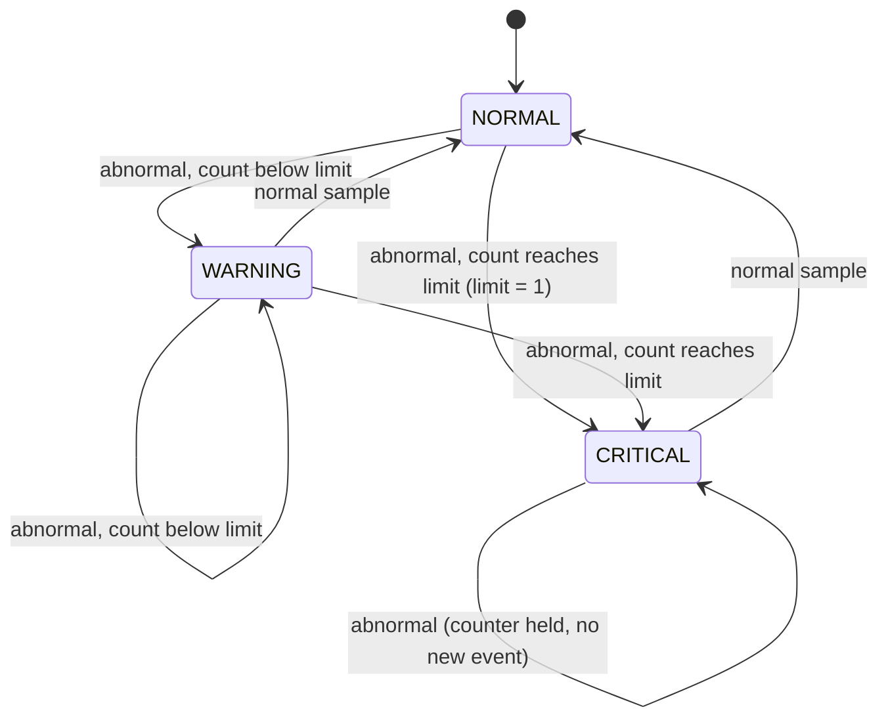

`enable = 0` or `rst_n = 0` returns the FSM to NORMAL from any state.

## 6. Technology Stack and Tools

| Stage | Tool |
|---|---|
| Hardware description | Verilog HDL |
| RTL / gate-level simulation | Icarus Verilog |
| Waveform inspection | GTKWave |
| Logic synthesis | Yosys (workshop run; OpenLane run used Yosys 0.9+3621) |
| Standard-cell library | SKY130A / `sky130_fd_sc_hd` |
| Physical design | OpenLane v0.21 (OpenROAD 0.9.0, TritonCTS, TritonRoute) |
| Timing analysis | OpenSTA (`timing/run_sta.tcl`) |
| Layout inspection / verification | Magic 8.3 (DRC), KLayout, LVS and CVC steps of the OpenLane flow |

## 7. Repository Structure

```text
sensor_anomaly_asic/
├── rtl/sensor_anomaly_detector.v
├── tb/tb_sensor_anomaly_detector.v
├── constraints/sensor_anomaly_detector.sdc
├── openlane/
│   ├── config.tcl
│   ├── pin_order.cfg
│   ├── run_console.log          # run tag sensor_run1
│   └── run_console2.log         # run tag sensor_run2 (matches final_summary_report.csv)
├── evidence/
│   ├── screenshots/
│   │   ├── rtl_to_gls/          # 01–07: RTL, testbench, RTL sim, Yosys, GLS
│   │   └── 01_floorplan.png … 06_final_layout_magic.png
│   ├── graphs/                  # timing graphs generated from the STA data
│   ├── sta_report.md            # 10 ns comparison table
│   └── sta_report_15ns.md       # 15 ns comparison table
├── results/
│   ├── final_summary_report.csv
│   ├── sensor_anomaly_detector.gds
│   ├── sensor_anomaly_detector.spef
│   └── sensor_anomaly_detector.synthesis_preroute.v   # OpenLane pre-route netlist (see §11.3)
├── timing/
│   ├── prelayout/   postlayout/  # one OpenSTA log per PVT corner (16 each)
│   └── run_sta.tcl
└── README.md
```

## 8. RTL Design

[`rtl/sensor_anomaly_detector.v`](rtl/sensor_anomaly_detector.v) is a single module of about 70 lines. Its building blocks:

- **Comparator:** `abnormal = (sensor_data > threshold)`.
- **Limit handling:** `limit_eff` maps `persistence_limit = 0` to 1.
- **Incrementer / limit compare:** `count_next = persistence_counter + 1`, `limit_hit = (count_next >= limit_eff)`.
- **State register and counter:** updated in one `always @(posedge clk)` block with synchronous reset.
- **Event flag:** registered, defaults to 0 every cycle, set only on entry to CRITICAL.
- **Outputs:** `warning = state[0]`, `critical = state[1]`.

<p align="center">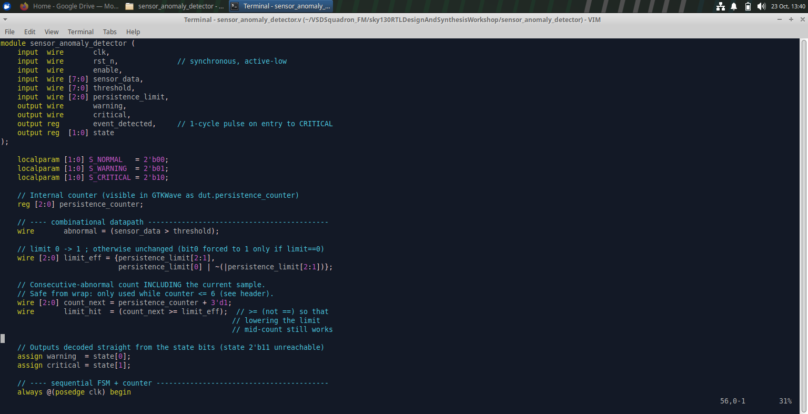<br><em>Figure 1: RTL source — module interface and combinational/sequential logic.</em></p>

## 9. Functional Verification and Testbench

[`tb/tb_sensor_anomaly_detector.v`](tb/tb_sensor_anomaly_detector.v) is plain Verilog-2001. Inputs change 1 ns after a clock edge, and outputs (state, warning, critical, event, internal counter) are checked 1 ns after the edge that captured the sample. A separate counter measures how many clock cycles `event_detected` is high. Each test prints PASS or FAIL, and a summary closes the run.

| # | Scenario |
|---|---|
| 1 | Reset held while the input is abnormal |
| 2 | Normal values, including a value equal to the threshold |
| 3 | One abnormal sample, then normal |
| 4 | Two abnormal samples with limit = 3 (no CRITICAL) |
| 5 | Three abnormal samples with limit = 3 → CRITICAL |
| 6 | `event_detected` lasts exactly one clock cycle |
| 7 | Input stays abnormal in CRITICAL: `critical` held, no repeated events |
| 8 | Return to normal → NORMAL |
| 9 | `persistence_limit = 1` |
| 10 | `enable = 0` (idle, in WARNING, in CRITICAL) |
| 11 | Reset during WARNING |
| 12 | Reset during CRITICAL |
| 13 | `persistence_limit = 0` behaves as 1 |
| 14 | `persistence_limit = 7`, no counter wrap |

<p align="center">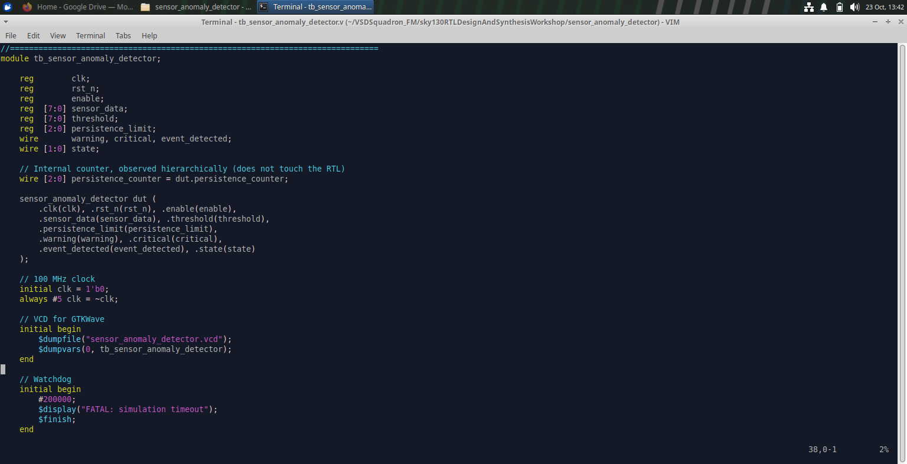<br><em>Figure 2: Testbench — signals, DUT connection, clock generation and waveform dump.</em></p>

## 10. RTL Simulation (Icarus Verilog) and Waveforms (GTKWave)

RTL simulation evaluates the behavioral Verilog before any technology cells are involved. The testbench checks the RTL's response against expected values for each scenario above.

Run from the directory containing both source files:

```bash
iverilog sensor_anomaly_detector.v tb_sensor_anomaly_detector.v
```
Compiles the RTL and testbench into the default simulator executable `a.out`.

```bash
./a.out
```
Runs the simulation, prints the per-test PASS/FAIL lines and summary, and writes `sensor_anomaly_detector.vcd` (name set by `$dumpfile` in the testbench).

```bash
gtkwave sensor_anomaly_detector.vcd
```
Opens the waveform. Add `clk, rst_n, enable, sensor_data, threshold, persistence_limit, warning, critical, event_detected, state` and the internal `persistence_counter` (under `dut`).

<!-- Add evidence/screenshots/rtl_to_gls/03a_rtl_simulation_terminal.png (RTL terminal PASS summary) here once captured. -->

What the waveform should show: `persistence_counter` stepping up on consecutive abnormal samples and clearing on a normal sample, reset or disable; `warning` high only in state `01`; `critical` high in state `10`; `event_detected` a single-cycle pulse aligned with the first cycle of `critical`.

<p align="center">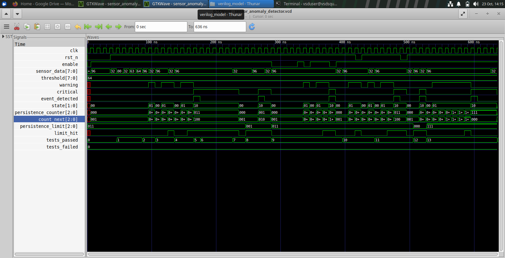<br><em>Figure 3: RTL simulation — GTKWave view of the design signals.</em></p>

## 11. Logic Synthesis (Yosys)

### 11.1 Workshop synthesis flow (used for gate-level simulation)

```tcl
read_liberty -lib lib/sky130_fd_sc_hd__tt_025C_1v80.lib
```
Loads the SKY130 cell definitions so Yosys knows the technology cells.

```tcl
read_verilog sensor_anomaly_detector/sensor_anomaly_detector.v
```
Reads the RTL.

```tcl
synth -top sensor_anomaly_detector
```
Runs generic synthesis on the selected top module.

```tcl
abc -liberty lib/sky130_fd_sc_hd__tt_025C_1v80.lib
```
Maps the logic network to the library cells.

```tcl
show
```
Opens a graphical view of the current logic network.

```tcl
stat
```
Prints cell types and counts.

```tcl
write_verilog -noattr sensor_anomaly_detector_netlist.v
```
Exports the technology-mapped netlist without Yosys attributes; this is the netlist used for GLS in §12.

The captured statistics for this run show **44 cells**, including two sequential-cell types.

<p align="center">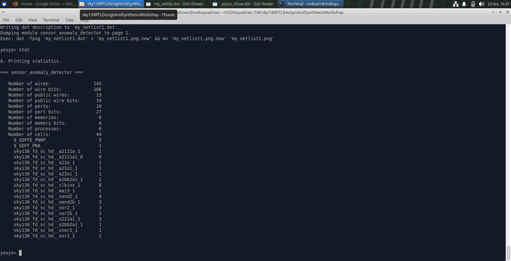<br><em>Figure 4: Yosys cell statistics from the workshop RTL-to-netlist run.</em></p>

<p align="center">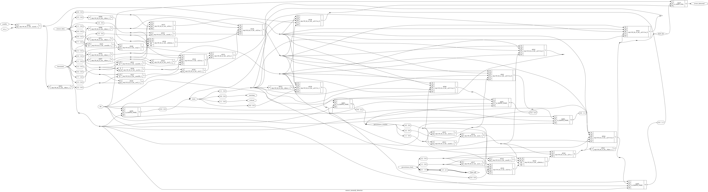<br><em>Figure 5: Yosys-generated diagram of the synthesized logic (structural view, not a layout).</em></p>

### 11.2 OpenLane synthesis (separate run)

OpenLane runs its own Yosys step (Yosys 0.9+3621, ABC strategy `AREA 0`, max fanout 5). Its log (`openlane/run_console2.log`) reports:

| Metric | Value |
|---|---|
| Cells | 56 (6 × `dfxtp_2` flip-flops + 50 combinational/buffer cells) |
| Chip area (cells only) | 496.7264 µm² |
| Memories / processes remaining | 0 / 0 |

### 11.3 Which count is which

| Source | Count | Notes |
|---|---|---|
| Earlier generic Yosys run (`synth; abc; stat`, no library) | 75 generic gates | Not technology-mapped |
| Workshop Yosys + SKY130 library (Figure 4) | 44 cells | Used for GLS |
| OpenLane synthesis log | 56 cells, 496.7264 µm² | Used by the physical-design flow |

These are different runs and settings and must not be compared as if they were one result. The file `results/sensor_anomaly_detector.synthesis_preroute.v` is the OpenLane powered netlist before routing; it also contains power pins and physical cells (tap, decap, fill) and is the netlist read by the post-layout STA scripts, not the netlist used for the RTL-to-GLS demonstration.

## 12. Gate-Level Simulation (GLS)

RTL simulation checks behavioral Verilog. GLS runs the same testbench on the synthesized netlist together with SKY130 Verilog simulation models, so it checks that the mapped gate-level circuit behaves as expected for the tested stimulus. It does **not** by itself prove timing closure, physical correctness or silicon behavior.

```bash
iverilog ../my_lib/verilog_model/primitives.v ../my_lib/verilog_model/sky130_fd_sc_hd.v sensor_anomaly_detector_netlist.v tb_sensor_anomaly_detector.v
```
Compiles the SKY130 primitive models, the standard-cell models, the synthesized netlist and the testbench into `a.out`. The model paths depend on where the SKY130 simulation models are stored.

```bash
./a.out
```
Runs the gate-level simulation and writes `sensor_anomaly_detector.vcd`.

```bash
gtkwave sensor_anomaly_detector.vcd
```
Opens the GLS waveform for comparison with the RTL waveform. Internal names may differ or be optimized in the netlist.

In the captured run the testbench reports **14 tests run, 14 passed, 0 failed, 0 total errors**. This applies to that netlist, testbench and set of simulation models only.

<p align="center">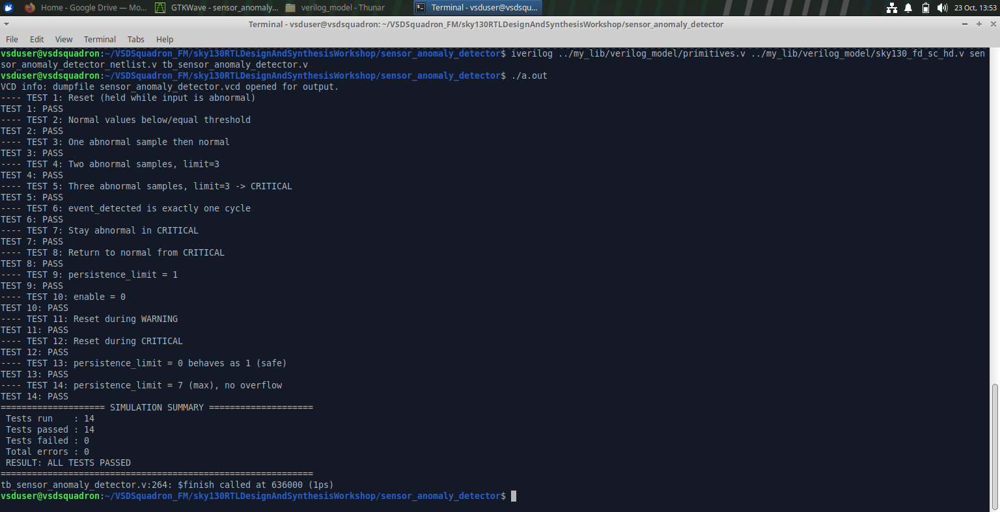<br><em>Figure 6: GLS terminal output — test summary.</em></p>

<p align="center">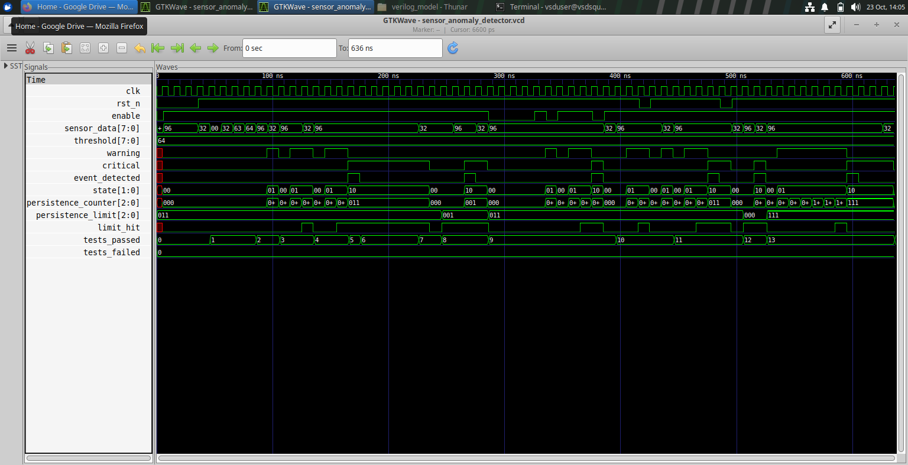<br><em>Figure 7: GLS waveform in GTKWave (compare with Figure 3, the RTL simulation).</em></p>

## 13. RTL-to-GDSII Physical Design (OpenLane)

### 13.1 Configuration ([`openlane/config.tcl`](openlane/config.tcl), [`constraints/sensor_anomaly_detector.sdc`](constraints/sensor_anomaly_detector.sdc))

| Setting | Value |
|---|---|
| OpenLane / OpenROAD / Magic | v0.21 / 0.9.0 / 8.3 rev 179 |
| PDK / library | sky130A / `sky130_fd_sc_hd` |
| Die | `FP_SIZING absolute`, `DIE_AREA 0 0 100 100` |
| Core (from log) | 88.96 µm × 78.24 µm |
| Clock | `CLOCK_PORT clk`, `CLOCK_PERIOD 15.0` |
| Placement | `PL_BASIC_PLACEMENT 1`, `PL_TARGET_DENSITY 0.10` |
| Other | `DESIGN_IS_CORE true`, `RUN_CTS true`, pins from `pin_order.cfg` (N: 11, W: 11, S: 5) |
| SDC | `create_clock` 15 ns, `set_clock_uncertainty 0.1` |

The OpenLane log warns that the core area is too small for the default power grid and that it minimized the power grid. The flow nevertheless completed without fatal errors.

### 13.2 Floorplanning
Defines the 100 µm × 100 µm die and core, places the I/O pins according to `pin_order.cfg`, and inserts tap and end-cap cells (146 fixed cells in the placement log) before the power grid is generated.

<p align="center">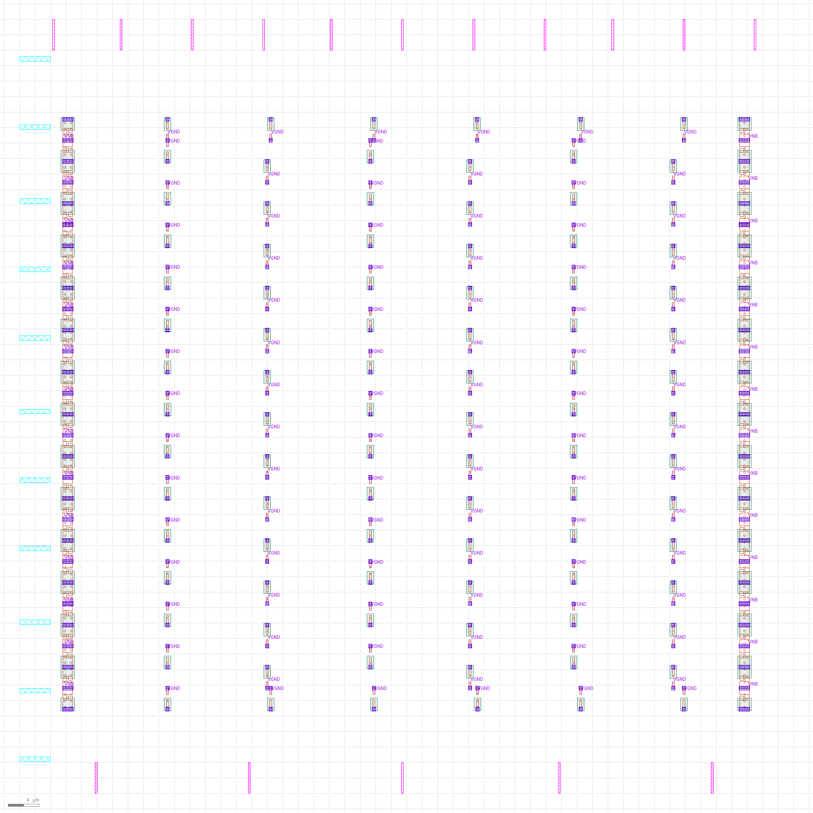<br><em>Figure 8: Floorplan.</em></p>

### 13.3 Placement
Global placement positions the 56 synthesized cells, followed by resizer optimization and detailed placement. OpenLane reports 9 % placement utilization.

<p align="center">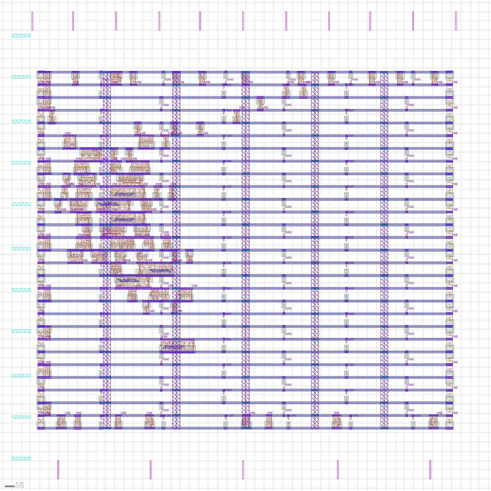<br><em>Figure 9: Standard-cell placement.</em></p>

### 13.4 Clock tree synthesis
TritonCTS builds the clock distribution for net `clk` to the six flip-flops, followed by clock-net wire repair and resizer timing optimization.

<p align="center">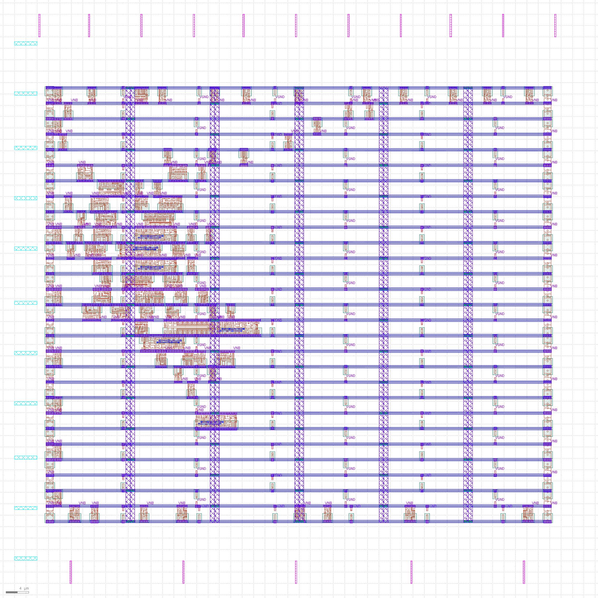<br><em>Figure 10: Layout after clock tree synthesis.</em></p>

### 13.5 Routing
Global routing (FastRoute) is followed by fill insertion and detailed routing (TritonRoute), which reports no DRC violations. SPEF parasitics are then extracted for post-layout STA. The summary report lists 2243 µm of wire and 505 vias.

<p align="center">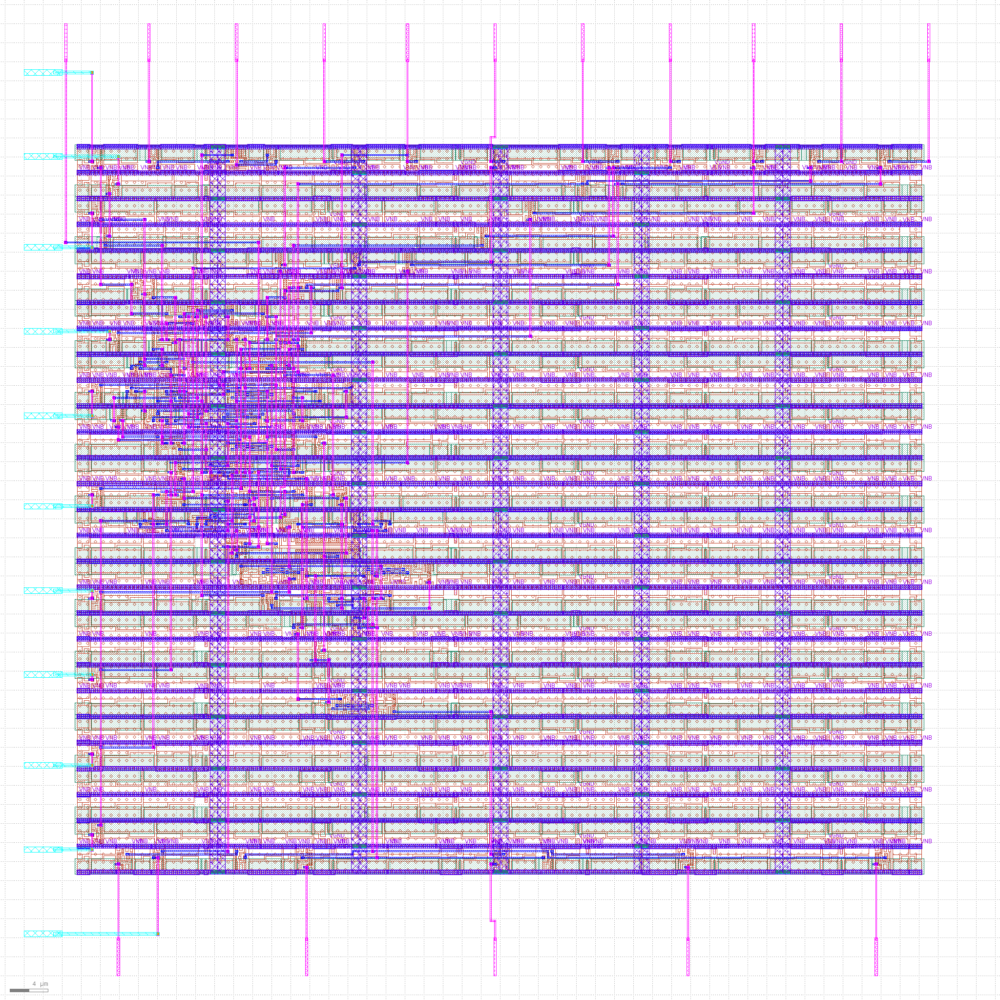<br><em>Figure 11: Routed design.</em></p>

### 13.6 Final layout and GDSII
Magic streams out the GDSII, KLayout regenerates a backup GDSII and runs an XOR comparison, and the flow then runs LVS, Magic DRC, antenna and CVC checks. The layout is in [`results/sensor_anomaly_detector.gds`](results/sensor_anomaly_detector.gds).

<p align="center">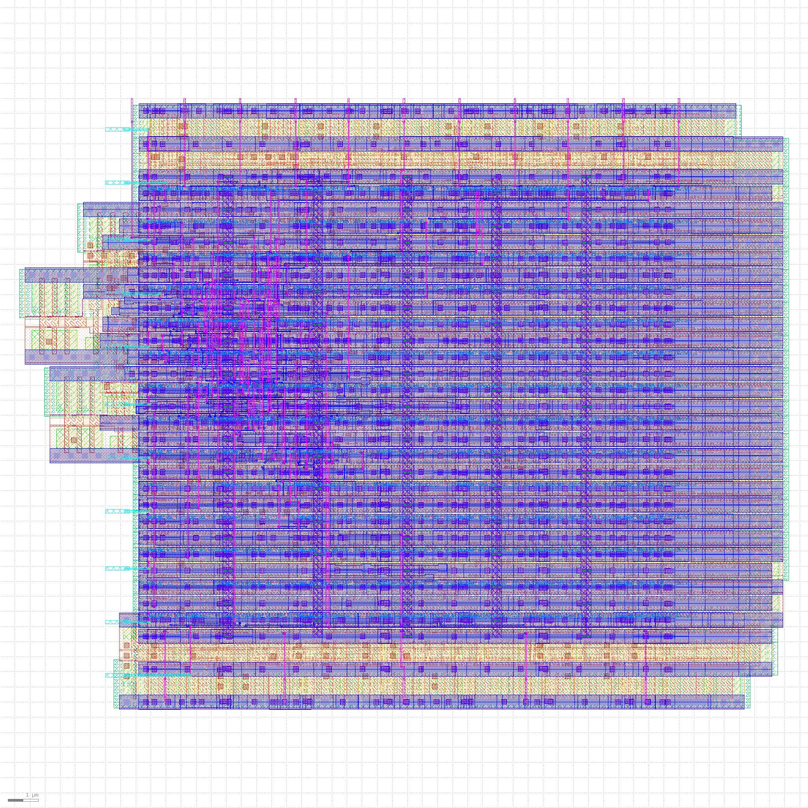<br><em>Figure 12: Final layout in KLayout.</em></p>

<p align="center">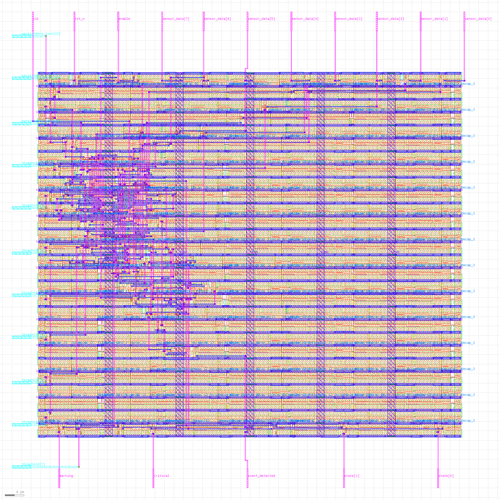<br><em>Figure 13: Final layout in Magic.</em></p>

### 13.7 Physical verification (reported by the flow, run `sensor_run2`)

| Check | Reported result |
|---|---|
| TritonRoute DRC violations | 0 |
| Magic DRC violations | 0 |
| LVS errors | 0 |
| Antenna violations | 0 |
| CVC errors | 0 |
| KLayout violations | `-1` in the CSV (not reported; not evidence of a pass) |

These are results from the OpenLane flow, not independent foundry signoff.

## 14. Static Timing Analysis

[`timing/run_sta.tcl`](timing/run_sta.tcl) loads a corner's Liberty file, the netlist, the SDC and (post-layout only) the SPEF, then runs `report_checks` for max (setup) and min (hold) paths in summary format. Logs for 16 PVT corners are in `timing/prelayout/` and `timing/postlayout/`; the exact wrapper that set the environment variables per corner is not stored in the repository.

- **Pre-layout:** no SPEF parasitics. The post-layout logs reference the powered pre-route netlist, which contains physical cells; the pre-layout logs show no such cells, so the netlist file used is not recorded in the repository.
- **Post-layout:** with `sensor_anomaly_detector.spef`.
- **Slack:** required time minus arrival time. Positive means the check passes under the SDC.
- **WNS (Worst Negative Slack):** the most negative slack among violating endpoints (0 or "none" when all slack is positive). **TNS (Total Negative Slack):** the sum of negative slacks over all violating endpoints. The summary logs list only the single worst path per check per corner, so TNS cannot be derived from them. OpenLane's own summary (`final_summary_report.csv`, 15 ns) reports WNS = TNS = 0.0 at all stages.

### 14.1 15 ns clock (matches `config.tcl` and the SDC)

| Metric | Worst corner | Pre-layout | Post-layout |
|---|---|---:|---:|
| Setup slack | `ss_n40C_1v28` | +2.2256 ns | +1.9052 ns |
| Hold slack | `ff_n40C_1v95` | +0.1844 ns | +0.1922 ns |

All 16 corners have positive setup and hold slack at 15 ns. Full per-corner tables: [`evidence/sta_report_15ns.md`](evidence/sta_report_15ns.md).

<p align="center"><br><em>Figure 14: Setup slack by PVT corner, pre- vs post-layout (15 ns).</em></p>

<p align="center"><br><em>Figure 15: Hold slack by PVT corner, pre- vs post-layout (15 ns).</em></p>

Post-layout setup slack is lower than pre-layout in every corner (by 0.03–0.32 ns) because of wire parasitics. The reported worst paths are flop-to-flop (`_101_/Q` → `_100_/D` for setup at `ss_n40C_1v28`).

### 14.2 10 ns comparison

[`evidence/sta_report.md`](evidence/sta_report.md) lists a 10 ns analysis. Every 10 ns setup value is exactly 5.000 ns below the 15 ns value and all hold values are identical, so it corresponds to re-evaluating the same netlist and parasitics against a 10 ns clock constraint rather than a separate 10 ns implementation (the OpenLane run used `CLOCK_PERIOD 15.0`).

| Clock | Worst setup (post-layout) | Corner |
|---|---:|---|
| 10 ns | −3.0948 ns (violation; pre-layout −2.7744 ns) | `ss_n40C_1v28` |
| 15 ns | +1.9052 ns | `ss_n40C_1v28` |

At 10 ns only `ss_n40C_1v28` fails setup; the next-worst corner (`ss_n40C_1v35`) has +0.9586 ns. Moving to 15 ns relaxes the constraint; it is not a hardware optimization.

<p align="center"><br><em>Figure 16: Post-layout setup slack for 10 ns and 15 ns clock periods.</em></p>

<p align="center"><br><em>Figure 17: Worst-case setup and hold slack summary.</em></p>

### 14.3 Caveats
- The SDC defines only the clock and its uncertainty. There are no input or output delay constraints, so I/O paths are **not** covered by these results.
- The logs contain Liberty warnings (`default_operating_condition ... not found` for the slow corner) and black-box warnings for tap/fill cells in the post-layout netlist.
- Positive slack in these reports is not complete timing signoff.

## 15. Results Summary

| Item | Result | Source |
|---|---|---|
| RTL simulation | 14 tests in testbench | `tb/` (terminal capture: see §10) |
| GLS | 14 run, 14 passed, 0 failed | Figure 6 |
| Synthesis (OpenLane) | 56 cells, 496.73 µm², 6 flip-flops | `run_console2.log` |
| Die (configured) | 100 µm × 100 µm (0.01 mm²) | `config.tcl`, summary CSV |
| Placement utilization | 9 % (OpenDP) | summary CSV |
| Wire length / vias | 2243 µm / 505 | summary CSV |
| DRC / LVS / antenna / CVC | 0 / 0 / 0 / 0 | summary CSV, run log |
| Setup / hold (15 ns, post-layout, worst corner) | +1.9052 ns / +0.1922 ns | `timing/postlayout` |
| Power | Not recorded in the repository | — |

## 16. Limitations and Future Improvements

- No I/O timing constraints (`set_input_delay` / `set_output_delay`), so I/O timing is unverified.
- No power report is stored.
- The OpenLane launch command and the per-corner STA wrapper are not recorded; adding them would make the flow reproducible.
- GLS and RTL simulation use directed tests only; no formal or randomized checking.
- A tool-flow result is not foundry signoff, and the design has not been evaluated for deployment in safety-critical infrastructure.
- Confirm that the RTL, netlists, reports and GDSII all correspond to the same design revision.

## 17. Conclusion

The project takes a small persistence-based anomaly detector from Verilog RTL to a GDSII layout on SKY130A with an open-source flow. The design was verified in RTL simulation and in gate-level simulation (14/14 tests in the captured GLS run), implemented with 56 standard cells in a configured 100 µm × 100 µm die, and reported clean by the flow's DRC, LVS, antenna and CVC checks. Post-layout STA at a 15 ns clock shows positive setup and hold slack in all 16 PVT corners under the stated constraints, with the limitations listed above.
